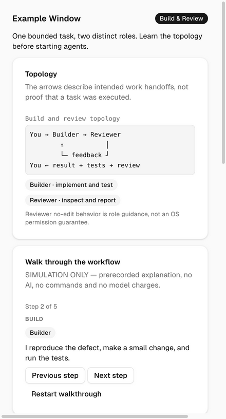

# OpenRig for Orca

**tmux-backed OpenRig, Orca-fronted UI.** An Orca plugin that works without a preinstalled OpenRig. OpenRig retains ownership of team execution and seat lifecycles; Orca provides setup guidance and terminal views.

> Early release `0.1.0`. Real Orca/OpenRig integration has been validated on macOS. Linux installer branches have unit coverage; remote workspaces and native Windows are not supported yet.

## Architecture

```text
Orca native panel / terminal
        |
OpenRig for Orca worker
        | rig CLI
OpenRig daemon + team / seat
        |
       tmux                  <- Required, not replaced
```

- **Required:** Orca `>=1.4.248`, this plugin, compatible Node, OpenRig, and tmux.
- **Agents:** Choose Claude Code, Codex, both, or configure later. Installation and daemon setup can finish without an agent; agent-team execution remains unavailable.
- **Not required:** Herdr, cmux, Ghostty, or a separate terminal app.
- **Optional:** Homebrew, nvm, curl, jq, git, gh, and Docker. Individual features or projects may need them, but they are not universal installation gates.
- OpenRig installation is pinned to **`0.7.13`**. Node 22 and 24 are checked; Apple Silicon Macs require Node 22 under the current OpenRig compatibility guidance.

## Load into Orca

On the host running Orca:

```sh
orca plugin validate . --json
orca plugin dev load . --json
```

Because this plugin runs code, Orca returns its requested grants and a **fingerprint for that exact approval request**. Review them, then rerun the command Orca provides with `--approve ...`. Never hardcode a fingerprint or copy one from another installation.

Requested access:

- `trusted-worker`: Runs a separate Node process with your account's permissions. This is not an OS security sandbox.
- `workspace:read`: Lists destination workspaces.
- `terminal:send`: **Creates new Orca terminals and runs commands**.
- `storage:own`: Stores plugin configuration and recent view connections.

The plugin does not request account-secret storage, access to existing terminal output, or automatic agent-launch capabilities. However, a trusted worker itself has your account's file and process access, so approve only source you trust.

After approval, open the setup panel:

```sh
orca plugin open local.openrig-for-orca --panel openrig --json
```

Local-folder installation is also available. Its installed copy is separate from the development folder and requires the same code-execution approval.

```sh
node scripts/stage.mjs
# Run the printed inspect/install commands against the temporary staging directory.
```

Use the **staging directory** for local-folder installation. Orca's content inspection is separate from Git's `.gitignore`; packaging a source directory containing development `node_modules` symlinks or local indexes/sockets can fail. The staging script copies only allowlisted runtime files and documentation and refuses to overwrite a nonempty destination. Do not commit generated files for Git distribution.

`local.openrig-for-orca` is the local development-folder key. For Git distribution, Orca derives the publisher from the repository owner. This repository has not been published or released.

## Example Window: explore a team first

Open **Example Window** using the lightbulb icon in Orca's right sidebar, or run:

```sh
orca plugin open local.openrig-for-orca --panel examples --json
```

- **Walkthrough:** Explains `You -> Builder -> Reviewer -> Builder -> You` step by step. This simulation runs no commands or models.
- **Terminal demo:** Uses an installed OpenRig and a no-agent daemon to create two real tmux seats. Their prerecorded role descriptions are labelled **SIMULATION ONLY**; they do not pretend to perform AI work or exchange messages. Try opening/closing views and the separate **Stop demo** action.
- **Claude/Codex templates:** Create two agents using the same provider, their RigSpec and AgentSpecs, role guidance, and a small clamp() example project. Existing project files are not overwritten, and creation does not launch agents.
- **Preview real team launch:** After authenticating the selected provider, review a private frozen bundle. The terminal shows declared settings and explicitly unverified native/model/host settings. Acknowledge those with `ACCEPT UNVERIFIED SETTINGS`, then type `LAUNCH`. Model usage may incur charges.

Orca 1.4.258's public plugin API does not create standalone OS windows, so Example Window is a **separate native sidebar panel**. It uses no additional browser or terminal app.



## First use

1. Explicitly select a local workspace in **Destination Orca workspace**. Both destination selectors show **project name / worktree name**, with a path suffix for duplicate names. Selection still uses Orca's exact workspace ID; changing a label never changes the target.
2. Use **Setup -> Recheck environment** to inspect Node/npm, OpenRig, tmux, and SQLite.
3. Select an installation action for missing OpenRig or tmux. **Review the exact command, source, write scope, and warnings** before running it in an Orca terminal. Opening a terminal does not prove installation succeeded.
4. Inspect the terminal result and recheck the environment.
5. Choose a coding agent and select **Save configuration**. Reuse an available CLI login or open its official sign-in command in an Orca terminal. Choosing `Later` is also valid.
6. Select **Start daemon · no agents** to start only this instance. No kernel or agent starts automatically. Inspect its terminal, then **Recheck environment**. Setup shows whether this instance is reachable; **Open dashboard** stays disabled until it responds. The worker rechecks the connection both before preparing and before executing a dashboard plan. The dashboard runs standalone `rig tui`: `--shared` requires a kernel-owned terminal and is incompatible with the initial no-kernel setup.
7. Refresh the seat list in **Teams**, then select **Open seat view**. Connections default to read-only; disable read-only and open a new view to provide input.

Action buttons prepare a **Review card above the Setup/Teams/Paths sections**, not an installation or launch. The long setup form is temporarily replaced so the review is not hidden below it. The card identifies the destination workspace and requires explicit confirmation. Cancel the review or select a settings tab to return to editing; changing tabs invalidates the pending plan. Example Window likewise replaces its walkthrough/actions with the pending review until you cancel, confirm, or change destination.

Immediately before execution, confirmed commands are stored as private scripts with mode `0600` under `<data>/actions/`. This accommodates Orca's terminal-command length limit without accepting a command different from the reviewed plan. These scripts contain explicit environment paths and the reviewed command, not secret values.

Orca's `terminal.create` receipt does not prove that a tab is visible. After creation the trusted worker uses the same host/profile's Orca CLI to inspect **only that terminal handle**, resolve the host API's identity selector to the CLI's workspace ID, switch to its destination workspace/tab, and verify that it is connected to the renderer. Identity resolution checks the exact instance and local host, never just a matching project path. This may change the workspace you are viewing. It never resends the action or creates another terminal as a visibility fallback. The CLI's terminal metadata can include an output preview; that preview is neither returned to panels nor saved by this check. No additional manifest capability is requested.

The panel distinguishes **Terminal tab connected** from **Terminal created · tab not verified**; neither means the command succeeded. **Show / recover existing terminal** retries only the view connection. A copyable recovery command is provided when the CLI/profile is unavailable; it preserves an explicit `ORCA_USER_DATA_PATH` when present. Recover the existing terminal rather than repeating an installation or launch. Recovery receipts contain only terminal/workspace identity and action title, never terminal output, and are saved in plugin storage. A storage failure keeps the accepted receipt visible but may prevent button-based recovery after a worker restart.

Each Open seat view click creates a separate view. **Closing a tab detaches from tmux; it does not stop the seat.** Stop or recover teams through the OpenRig dashboard or explicit lifecycle operations.

### Launch a team

- The shipped `starter` uses both Claude and Codex. For a single provider, use an Example Window template or an adapted local YAML spec.
- Verified launches require an **absolute local YAML spec**. Export library specs locally first. Unresolved library names and remote URLs are not accepted by this path.
- Preparation uses OpenRig 0.7.13's bundle assembler and integrity inspector to freeze declared specs and resources under `<data>/launches/`. No agents start during preparation, but private review files are created.
- Both the panel and terminal show bundle-derived runtime, model and permission declarations. Native defaults and effective host enforcement that cannot be verified are labelled **UNVERIFIED**, not assumed safe.
- The terminal previews that same bundle. When uncertainties remain, type **`ACCEPT UNVERIFIED SETTINGS`** before **`LAUNCH`**. Other input cancels. No automatic permission bypass or model substitution is added.
- Execution uses the frozen archive, not the mutable source YAML. Changing original specs or role files does not change the approved launch. Archive changes or an expired five-minute review block execution and require a new review.
- Native host settings and installed runtime integrations are outside the archive. This is a consent and input-integrity boundary, not an OS sandbox or protection against another process controlling the same user account.

## Paths, accounts, and installation policy

Use **Paths** to set absolute paths or `~/...` overrides.

- Default data directory: `~/.local/share/openrig-for-orca/`
- Managed CLI: `<data>/runtime/node_modules/.bin/rig`
- Optionally installed agent CLIs: `<data>/providers/node_modules/.bin/`
- OpenRig state: `<data>/instance/`
- Private frozen reviews and materialization targets: `<data>/launches/`. Treat these as potentially sensitive and never upload or commit them.
- Daemon: loopback `127.0.0.1` only; the default port is `43811`, configurable in Paths.

Discovery checks Node near existing agents and on PATH, then reuses a compatible runtime. It does not automatically install nvm or a new Node, or edit shell startup files. **An embedded Electron runtime is not assumed to be an ordinary Node installation.** If no compatible standalone runtime exists, the plugin links to official Node installation guidance.

OpenRig installs into a private directory rather than a global npm prefix. The plugin does not automatically run `rig setup`, avoiding Herdr installation and changes to personal tmux settings. When `op` is found, npm actions use `op plugin run -- npm ...`. Approve 1Password in the terminal when required; credentials are neither extracted nor bypassed. **The 1Password npm plugin requires the command name `npm`**, so retain the selected Node's PATH and make advanced npm overrides match it.

On macOS, the installer uses existing Homebrew or MacPorts. On Linux, it uses a detected apt/dnf/yum/pacman/zypper/apk installation. Without a supported package manager, it provides official tmux guidance and executable-path overrides. It does not silently bootstrap Homebrew or pipe a remote shell script into execution.

### Authentication boundaries

- Existing CLI environments and selected `CODEX_HOME` / `CLAUDE_CONFIG_DIR` paths can be reused.
- Orca's current plugin host API does not export managed accounts. Orca logins or API keys are not automatically converted into CLI logins.
- Only the success status of CLI `auth status` / `login status` is used; their output and tokens are not retained in panels or plugin storage.
- Changing account paths or runtime configuration does not change an already-running daemon's environment. Safely settle active teams and use OpenRig's explicit stop/start procedure to apply the new environment. The plugin does not restart it automatically.

**Changing `OPENRIG_HOME` alone does not isolate provider settings or personal skill directories.** OpenRig startup can write discovery skills; team startup can write trust, hooks, and project guidance. Execution plans disclose those effects. Use a separate Orca profile and effective HOME for isolated testing. This separates configuration and state paths; it is not a security container.

## Development and testing

No compilation build step is required: Orca loads TS/TSX directly. Run development commands in the source checkout; staging directories contain only runtime files and documentation. Generate development types from the installed Orca.

```sh
orca plugin types . --json
# When using the 1Password npm plugin, as in this environment:
op plugin run -- npm ci
./node_modules/.bin/tsc --noEmit -p .
node --test test/*.test.mjs
orca plugin test . --json
orca plugin check . --json
```

Without 1Password integration, use ordinary `npm ci` to install development dependencies.

Ordinary tests use Node and Git for publication-policy fixtures, **not CircleCI, Orca, or a model account**:

```sh
node --test test/*.test.mjs
```

Run the disposable smoke test from first installation onward:

```sh
node scripts/sandbox.mjs --install --approve-plugin --output ci-results/local-live
```

These options explicitly authorize external package downloads and **approval of this test plugin's exact grants**. Each run copies the plugin outside the source tree and uses a separate Orca profile, OpenRig state directory, HOME, and unused port. Only npm installation reuses the existing npm/1Password environment and cache. The test does not launch agents or copy logins.

To skip the network installation using an existing rig:

```sh
OPENRIG_TEST_RIG=/absolute/path/to/rig node scripts/sandbox.mjs --approve-plugin
```

Following Orca 1.4.258's own E2E approach, the test seeds `orca-data.json` in **a new empty test profile only**, dismissing onboarding and first-use tips with telemetry disabled. It does not assume a public `--skip-onboarding` option or modify existing user profiles, running databases, or TCC permissions. Real panel capture works without computer use on this version.

Add `--keep` to retain the sandbox for manual inspection. Otherwise, the test cleans up its team, daemon, plugin, terminals, and verified sandbox processes, leaving a report. Administrator or 1Password approval requirements are never bypassed.

**Do not place running sandbox state inside the development plugin source directory.** It can interfere with file watching and reloads. If a worker retains an old dependency after an edit, explicitly run `orca plugin restart local.openrig-for-orca --json`. Worker restarts discard pending execution plans.

## CircleCI macOS

`.circleci/config.yml` follows the managed macOS setup in `dsh-session-cleanup`. A checksum-pinned Gitleaks job checks Git history and current commit candidates first. Xcode 26.4.1 / m4pro.medium then independently runs Node 22 and 24 core tests and the **Node 22 live Orca/OpenRig suite**. Orca ARM64 1.4.258 installs into a private directory after verification of the official DMG's pinned SHA-256 and signature. Jobs do not sign in to accounts, run paid agents, or deploy anything.

JUnit, allowlisted logs, and example screenshots are collected. Missing required checks, installation, either seat, attach/detach, explicit stop, template validation, or cleanup fail the suite. A Node 24 core pass does not establish Apple Silicon OpenRig execution support.

Run `node scripts/scan-secrets.mjs` for a quick Git-candidate check, or `node ci/check-secrets.mjs --bootstrap` for the pinned full history/current-candidate gate on macOS ARM64. Reports contain locations and rule IDs, not credential values. Common credential/key/state files are ignored, but force-staged files and historical secrets still need detection.

CI-owned application downloads are removed in `finally`; an externally supplied `--orca-cli` installation is never removed. Validation failures outside command steps produce failed JUnit cases as well as a nonzero exit. An accepted terminal receipt remains visible even if metadata storage or a subsequent list refresh fails.

See [SECURITY.md](SECURITY.md) for publication safeguards and reporting, [docs/CI.md](docs/CI.md) for connection settings, triggers and validation boundaries, [SPEC.md](SPEC.md) for the contract, and [docs/TESTING.md](docs/TESTING.md) for evidence.
